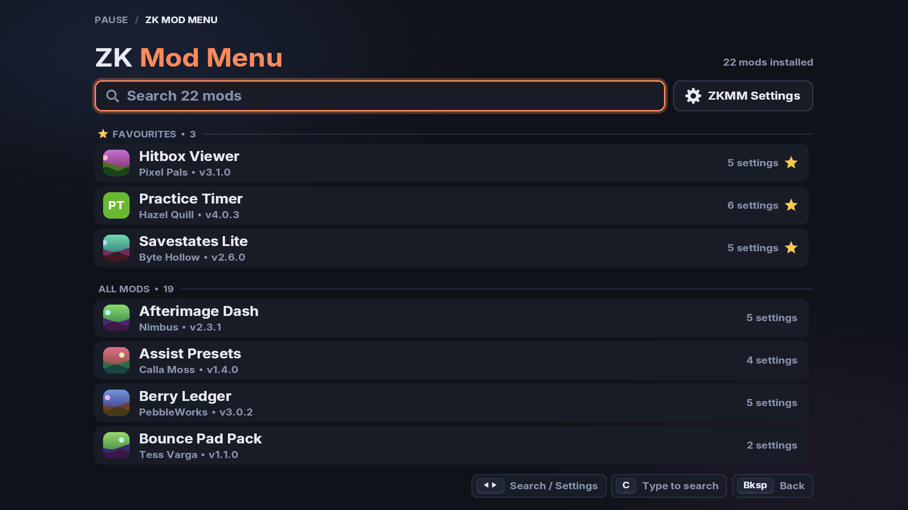
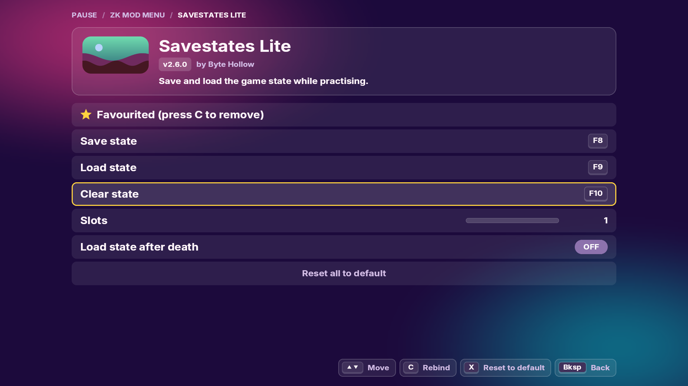
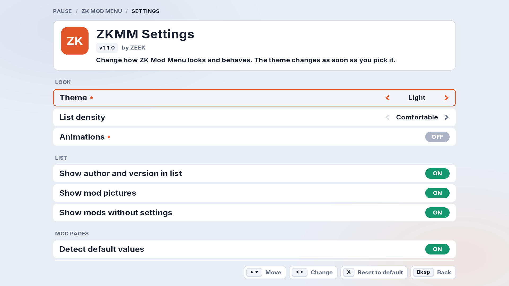
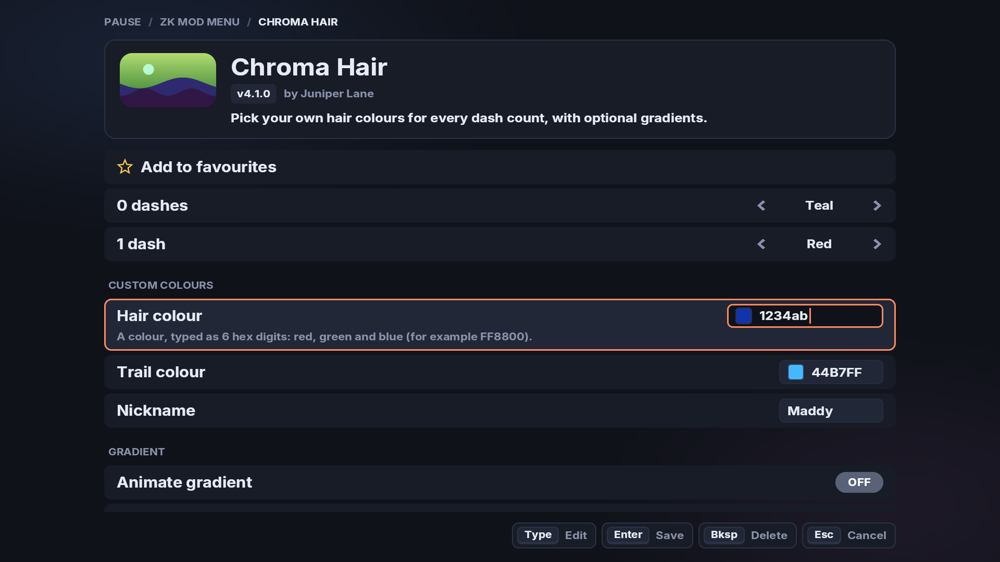

# ZK Mod Menu (ZKMM)

A mod settings menu for Celeste, made for players with a lot of mods.

Celeste's mod loader, [Everest](https://everestapi.github.io/), puts the settings of every installed mod into one long "Mod Options" list. With dozens of mods that list gets hard to find anything in. ZK Mod Menu adds a **ZK Mod Menu** entry to the pause menu instead: a searchable A to Z list of your mods, with favourites pinned to the top, where every mod opens a full page of its own.



<sub>Preview renders from the development harness, using made-up mods and a stand-in font. They are not in-game screenshots.</sub>

> [!WARNING]
> **Status: 1.1.0, untested in game.** This version compiles against Everest and its menu logic and drawing pass an offline test harness, but it has **not yet been run inside Celeste**. Expect rough edges, most likely text sizes with the game's real font. The online author, description and picture lookup was checked against the live database's format, but the download has not been run from inside the game. Bug reports are very welcome; see [Reporting a problem](#reporting-a-problem).

## Contents

- [Features](#features)
- [What's new in 1.1.0](#whats-new-in-110)
- [Install](#install)
- [Using it](#using-it)
- [Controls](#controls)
- [ZKMM Settings](#zkmm-settings)
- [How it works](#how-it-works)
- [Known limitations](#known-limitations)
- [Uninstall](#uninstall)
- [Building from source](#building-from-source)
- [How the code is laid out](#how-the-code-is-laid-out)
- [Reporting a problem](#reporting-a-problem)

## Features

- **One entry in the pause menu.** "ZK Mod Menu" sits right above Everest's own "Mod Options".
- **Mod list.** Every installed mod in A to Z order, with a search box at the top. Search matches a mod's name, its ID and its author.
- **Favourites.** Favourite the mods you change most and they stay pinned above the rest.
- **A page per mod.** The mod's picture, name, version, author and description at the top, then a Favourite button, then that mod's settings grouped under its own sub-headers, then "Reset all to default".
- **Mod pictures.** Each mod's first screenshot from the public mod database, on its page and as a small icon in the list.
- **Every kind of setting.** Switches, sliders, choices, buttons, key bindings and text. Key bindings are changed right on the page.
- **Text and colour settings in a level.** Everest's Mod Options only lets you change text settings (such as a hex hair colour) from the title screen. In ZKMM you type them right on the page, with a live colour swatch for hex colours.
- **Reset to default.** Reset one setting, a whole mod, or every mod at once.
- **Three themes.** Dark, Light and Colourful, switchable at any time.
- **Keyboard and controller.** Everything works with arrow keys or WASD plus two buttons, or a controller.
- **Works with every mod as it is.** Mods do not need to support ZKMM. The settings on a mod's page are the same ones that mod shows in Everest's Mod Options.

| Mod page, Colourful theme | ZKMM Settings, Light theme |
| --- | --- |
|  |  |

| Typing a hex colour on a mod's page |
| --- |
|  |

<sub>Also harness renders with made-up mods and made-up pictures, not in-game screenshots.</sub>

## What's new in 1.1.0

- **Authors and descriptions show up.** The public mod database changed its format, so 1.0 never found any mod in it. ZKMM now matches mods through the file they are downloaded from, which finds every mod that Everest's updater knows.
- **Mod pictures.** Each mod's screenshot on its page and in the list.
- **Text and hex colour settings can be changed in a level**, typed right on the mod's page with a live colour swatch.
- Includes 1.0.1: no more softlock when backing out of a mod's own screen.

## Install

You need Celeste with **Everest** installed. Everest is installed with [Olympus](https://everestapi.github.io/), the Celeste mod manager. ZKMM needs one of the current .NET Core builds of Everest (build 5000 or newer); any up to date Everest is fine.

1. Get `ZKModMenu.zip`. There are no published downloads yet, so for now [build it from source](#building-from-source); that section ends with how to make the zip.
2. Find your Celeste folder. On Steam: right click Celeste, then **Manage → Browse local files**. Olympus also shows the folder of the install it manages.
3. Copy `ZKModMenu.zip` into the `Mods` folder inside it. Do not unzip it; Everest loads mod zips directly.
4. Start the game. Pause in any level and choose **ZK Mod Menu**.

To update, replace the old `ZKModMenu.zip` with the new one. Your favourites and ZKMM options are kept.

## Using it

**Opening it.** Pause in a level and choose **ZK Mod Menu**. Leaving the menu with Back brings you back to the pause menu with the entry still selected.

**The list.** The top row holds the search box and the **ZKMM Settings** button; Left and Right switch between them. Below that are your favourites, then every other mod, both in A to Z order. Each row shows the mod's name, author, version and how many settings it has (the author and version line can be turned off).

**Searching.** Move to the search box and press Confirm, type, then press Enter (or Down) to jump into the results. Esc stops typing and keeps what you typed. To clear the search, move to the search box and press X.

**Favourites.** Press X on a mod in the list, or use the Favourite button at the top of its page. Favourites are saved with your other ZKMM options.

**A mod's page.** Move up and down through the settings and change them with Left and Right (or Confirm for buttons and switches). Changes take effect straight away, exactly as in Everest's Mod Options, and the mod's settings are saved when you leave its page. X resets the selected setting to its default. A dot next to a setting's name means it is not at its default. "Reset all to default" at the bottom resets the whole mod. A mod that has no settings says so.

**Key bindings.** Select a binding row and press Confirm, then press the key or controller button you want. Delete removes the binding; Backspace or Esc cancels.

**Text and colour settings.** Select the row and press Confirm, type the new value, then press Enter to save or Esc to leave it as it was. A colour shows a swatch that follows what you type; it must be the same kind of hex code the mod uses (6 digits like `FF8800`, or 8 digits when the mod stores opacity too), with or without a `#`. Typing needs a keyboard. X puts the setting back to its default.

## Controls

| Action | Keyboard | Controller |
| --- | --- | --- |
| Move | Arrow keys or W A S D | D-pad or left stick |
| Select / press | C (your Confirm key) or Enter | A |
| Change a value | Left / Right | Left / Right |
| Favourite a mod (in the list), reset a setting (on a mod page), clear the search (on the search box) | X | X |
| Back | Backspace or Esc | B |
| Page up / page down / jump to search | Everest's own menu bindings | Everest's own menu bindings |
| Leave the menu and resume the game | | Start |

The X action is ZKMM's own binding and can be rebound in ZKMM Settings under **Controls**. Confirm and Back follow the game's own Confirm and Cancel bindings, so if you have rebound those, ZKMM follows.

## ZKMM Settings

Open them with the gear button next to the search box. The same options also appear under "ZK Mod Menu" in Everest's Mod Options.

| Section | Setting | Default | What it does |
| --- | --- | --- | --- |
| Look | Theme | Dark | Dark, Light or Colourful. Changes as soon as you pick it. |
| Look | List density | Comfortable | Compact fits more mods on screen. |
| Look | Animations | On | Smooth scrolling and page transitions. |
| List | Show author and version in list | On | The second line under each mod's name. |
| List | Show mod pictures | On | Each mod's first screenshot from the mod database, in the list and on its page. Off shows the coloured letter badges instead. |
| List | Show mods without settings | On | Off hides mods that have nothing to change (favourites and search results still show). |
| Mod pages | Detect default values | On | Lets ZKMM work out each setting's default so it can be reset. See [How it works](#how-it-works). |
| Mod pages | Look up author and description online | On | See [How it works](#how-it-works). |
| Mod pages | Restyle mods' own screens | On | Menus a mod opens from its page are shown as ZKMM pages. Off shows them the way the mod made them, in Celeste's own menu style. |
| Pause menu | Hide Everest's Mod Options button | Off | Removes the old entry from the pause menu. It stays available from the title screen. |
| Controls | Favourite / reset to default | X key, X button | Rebinds the X action. |
| Reset | Clear all favourites | | Press twice to confirm. |
| Reset | Reset all mod settings | | Puts every setting with a known default back to that default, for every mod. Press twice to confirm. |

## How it works

**The settings are each mod's own.** ZKMM does not keep a copy of anyone's settings and mods do not need to know about it. When you open a mod's page, ZKMM asks the mod to build its normal Everest Mod Options section into a hidden menu, then shows each of those items as a row on the page. Changing a row changes the real item, so the mod saves and reacts exactly as it would in Everest's Mod Options. A mod made of several Everest modules gets one page that holds all of them.

**Defaults.** Everest does not record what a setting's default is. To find out, ZKMM builds the mod's menu once more with a fresh, untouched settings object and reads the values from it. That is what X and "Reset all to default" go back to. This works for nearly every mod; a setting whose default cannot be found simply cannot be reset, and says so. If a mod's page ever misbehaves, turn **Detect default values** off.

**Author, description and picture.** A mod's `everest.yaml` only has its name and version, so Everest has no author, description or picture to show. ZKMM reads them from the public Celeste mod database that Everest's updater and Olympus already use (`everest_update.yaml` and `mod_search_database.yaml` on `maddie480.ovh`), matching each installed mod to its GameBanana page through the file it is downloaded from. It keeps the result in Everest's cache folder (`Mods/Cache/ZKModMenu.modinfo.txt`) and refreshes it in the background once a week. Pictures are fetched only for mods you actually look at, two at a time, from the database's PNG mirror (falling back to GameBanana's own JPEG). Each one is shrunk once and the small copy is kept in `Mods/Cache/ZKModMenu-images/`, so it is downloaded only once. Only plain downloads are made: nothing about you or your installed mods is sent. With no connection, or with **Look up author and description online** turned off, pages show no author or description, and only pictures already kept are shown.

**Text settings.** Everest builds a button for each text setting of a mod and greys it out in a level, because its text entry screen only works from the title screen. ZKMM recognises those buttons (they are named the way Everest names them: "Setting: value"), and turns each into a row you can type into. The new value is written to the mod's settings exactly as Everest's own screen would, and saved with the mod's other settings when you leave the page. Text settings a mod builds by hand, with its own menu code, are left as the mod made them.

**Where things are saved.** ZKMM's own options and your favourites are stored by Everest in `Saves/modsettings-ZKModMenu.celeste`, like any other mod's settings.

**Mods with their own screens.** Some mods have a button that opens a screen of their own. Such a button expects Everest's Mod Options underneath it, and each mod hands back in its own way: some take the options menu off screen and put it back when their screen closes, some switch it off and on again, some go back to the pause menu. ZKMM follows all of these. A plain menu is shown as a ZKMM page of its own, with the mod's name in the trail at the top, and Back does whatever that menu does when it is backed out of. A screen with code of its own (Everest's key config screens, for example) is shown as the mod made it while ZKMM waits behind it. A setting that opens inside the options menu itself is shown in that menu, in Celeste's own style, until it hands the controls back. If a screen goes back to the pause menu, ZKMM closes. And if a screen closes without handing back to anything, ZKMM loads the mod's page again after a moment, so the game is never left paused with nothing on screen.

## Known limitations

- **Not yet run in game.** See the status note at the top. The first in-game runs will very likely need small fixes.
- **Mods' own screens are followed, not understood.** ZKMM works out what a mod's screen is doing by watching the menus (see [How it works](#how-it-works)). The ways mods usually do this are covered, and a screen that leaves nothing behind is caught, but a mod that draws a screen without using a menu at all may look wrong inside ZKMM. If a restyled screen misbehaves, turn **Restyle mods' own screens** off; if it still does, use Everest's Mod Options for that mod and please report it.
- **Online lookup untested in game.** The database's current format was checked by hand and the reader was tested against real entries, but the download itself has not been run from inside Celeste. Mods that are not on GameBanana (or not in the database) have no author, description or picture.
- **Pictures.** GameBanana's WebP screenshots cannot be opened by the game, so a mod whose only pictures are WebP shows its letter badge. The pictures are decoded with the game's own image loader, off the main thread; this has not been run in game yet.
- **Title screen only settings.** Settings a mod only offers from the title screen do not appear, exactly as in Everest's in-game Mod Options. Use Everest's Mod Options on the title screen for those. (Plain text settings are the exception: see [How it works](#how-it-works).)
- **Pause menu only.** ZK Mod Menu is opened from the pause menu in a level. On the title screen, use Everest's Mod Options.
- **Default detection is a best guess.** A few mods may build their menus in ways that make a default impossible to read, and those settings cannot be reset from ZKMM.
- **Minimum Everest version.** `everest.yaml` asks for Everest 1.5000.0. That is a safe guess for the .NET Core builds, not a tested minimum.
- **English only** for now. All of ZKMM's own text is English.

## Uninstall

Delete `ZKModMenu.zip` from your `Mods` folder. To remove everything ZKMM left behind, also delete `Saves/modsettings-ZKModMenu.celeste`, `Mods/Cache/ZKModMenu.modinfo.txt` and the `Mods/Cache/ZKModMenu-images` folder. The settings of your other mods are untouched; ZKMM only ever changed them through the mods themselves.

## Building from source

You need the [.NET 8 SDK](https://dotnet.microsoft.com/download) (or newer) and a Celeste install with Everest. The build reads `Celeste.dll`, `FNA.dll` and `YamlDotNet.dll` from the game folder; they are only used to compile and are never copied into the mod.

```sh
# Easiest: put this repository inside Celeste/Mods/ and build there.
# The game's files are found two folders up.
dotnet build -c Release

# Anywhere else: point the build at your Celeste folder.
dotnet build -c Release -p:CelestePrefix=/path/to/Celeste
```

The result is `bin/ZKModMenu.dll`. With the repository inside `Celeste/Mods/`, Everest loads it straight from the folder, which is the quickest way to test changes: build, then restart the game.

To make an installable zip, put these three things at the top level of a zip named `ZKModMenu.zip`:

```
everest.yaml
bin/ZKModMenu.dll
Dialog/English.txt
```

**Building without owning the game.** V1 was compiled without a copy of Celeste, against a reference `Celeste.dll` built from the stripped game assemblies in Everest's own repository (`lib-stripped/`) patched with Everest's `Celeste.Mod.mm`. That route is fiddly and the resulting DLL must never be distributed; if you have the game, use it instead.

## How the code is laid out

```
Source/Core/      The whole menu: list, pages, rows, themes, input handling and drawing.
                  Knows nothing about Celeste. It draws through a small canvas interface
                  (rectangles, text, one image) and talks to mods through interfaces.
Source/Everest/   The connection to the game: the pause menu entry, input, drawing with the
                  game's font, saved options, the online mod database, and the code that
                  turns each mod's Everest menu items into rows.
Dialog/           ZKMM's text for Everest's Mod Options.
Harness/          A development tool, not part of the mod. It draws the Core to PNG files
                  with made-up mods, runs navigation checks, and plays through the ways
                  mods open and close screens of their own.
```

Because the Core has no game dependency, most of the menu can be worked on without starting Celeste:

```sh
cd Harness
dotnet run -c Release -- out-folder
```

The harness uses SkiaSharp and expects the Inter Bold font at `/usr/share/fonts/opentype/inter/Inter-Bold.otf` (the `fonts-inter` package on Debian and Ubuntu) as a stand-in for the game's font. The images in this README come from it.

## Reporting a problem

Please [open an issue](../../issues) with:

- what you did and what happened,
- your Everest version (shown on the title screen),
- the mod involved, if the problem is on one mod's page,
- the relevant part of `log.txt` from your Celeste folder (search it for `ZKModMenu`).

If a single mod's page misbehaves, turning off **Detect default values** in ZKMM Settings is a good first thing to try.
